## Why this matters beyond one dataset

::: {.big-question}
How can a city learn from sensor data without claiming more than the network can support?
:::

We use Melbourne's recorded **Noise** values to ask:

- When do values change?
- How do monitored sites differ?
- Do nearby activities give a stable explanation?

::: {.notes}
Speaker: Sandhya. Target: 50 seconds. Start with the broad problem of responsible sensor-based decisions, then narrow to the three project questions.
:::

## The evidence boundary comes first

::: {.columns}
::: {.column width="48%"}
### What we can say

- Results describe monitored locations.
- Time and site differences are observable.
- Contextual links can be explored.
:::

::: {.column width="48%"}
### What we cannot say

- The physical unit is unconfirmed.
- Calibration and mounting are unknown.
- The network is not city-wide.
- Association is not causation.
:::
:::

::: {.takeaway}
Every result is framed as **recorded Noise in dataset units**.
:::

::: {.notes}
Speaker: Sandhya. Target: 50 seconds. Explain why we do not use decibels, exposure, safety or city-wide language.
:::

## A defensible analytical sample

::: {.stat-grid}
::: {.stat-card}
**975,550**

raw records
:::
::: {.stat-card}
**893,959**

finite values
:::
::: {.stat-card}
**11 of 12**

usable sensors
:::
::: {.stat-card}
**2022–2026**

observed period
:::
:::

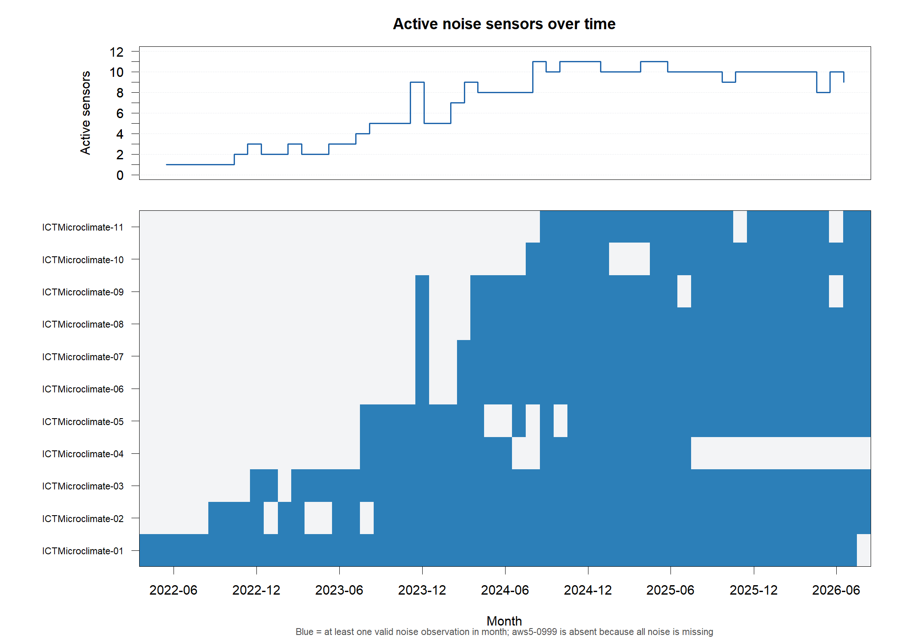{fig-alt="Monthly availability and coverage of sensors with usable recorded Noise values."}

**Decision:** retain recorded zeros in the primary analysis and exclude them only in a sensitivity check.

::: {.notes}
Speaker: Sandhya. Target: 1 minute 30 seconds. Cover the unusable device, unequal coverage, the zero-value decision and retained source checksums. Hand over to Xinlei.
:::

## Linking three data systems

::: {.flow-row}
**Noise sensors** → **projected 250/500/1,000 m buffers** → **pedestrian counters and hospitality records**
:::

::: {.columns .compact-columns}
::: {.column width="67%"}
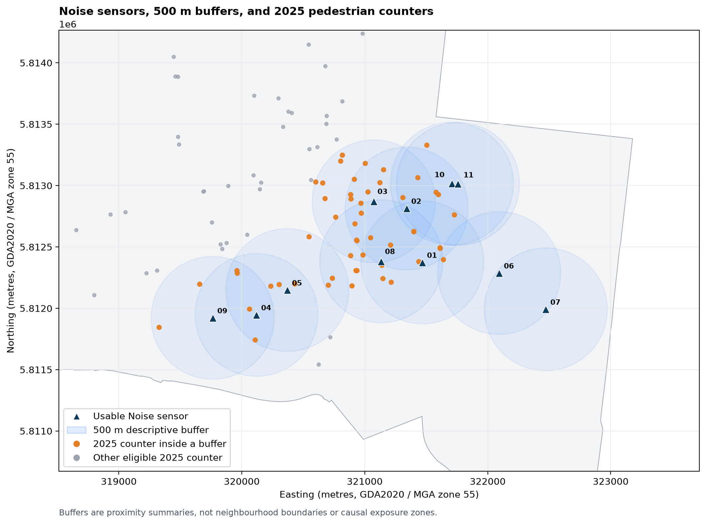{.slide-map fig-alt="Projected map showing labelled Noise sensors, 500 metre buffers, and pedestrian counters."}
:::

::: {.column width="30%"}
### Design choices

- Primary distance: **500 m**.
- Sensitivity: **250 and 1,000 m**.
- Pedestrian activity: **2025**.
- Hospitality context: **2024**.

Buffers describe proximity, not causal exposure.
:::
:::

::: {.notes}
Speaker: Xinlei. Target: 1 minute 5 seconds. Explain projected distance, overlapping buffers and why a buffer describes proximity rather than a causal exposure zone.
:::

## The clearest finding is a daily cycle

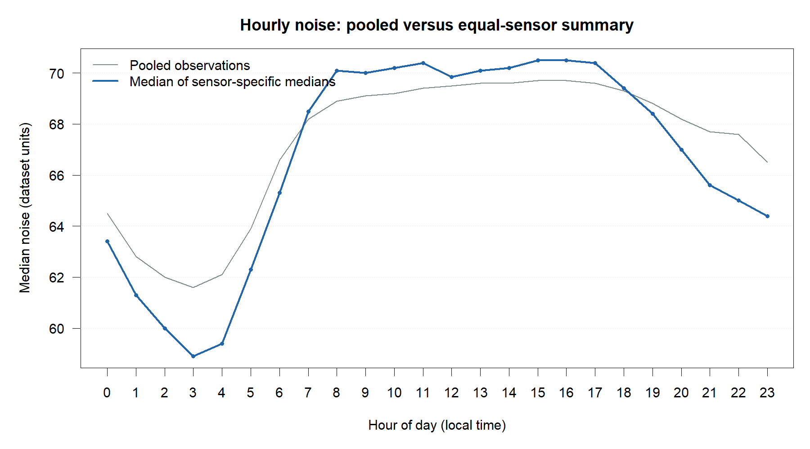{fig-alt="Hourly line chart comparing pooled medians with equally weighted sensor-specific medians."}

::: {.takeaway}
Values are lowest around **03:00** and highest around **15:00–16:00**. The shape remains after giving every sensor equal weight.
:::

::: {.notes}
Speaker: Xinlei. Target: 55 seconds. Explain why agreement between pooled and equal-sensor lines makes the pattern more credible within this network.
:::

## One line still hides site differences

::: {layout-ncol="2"}
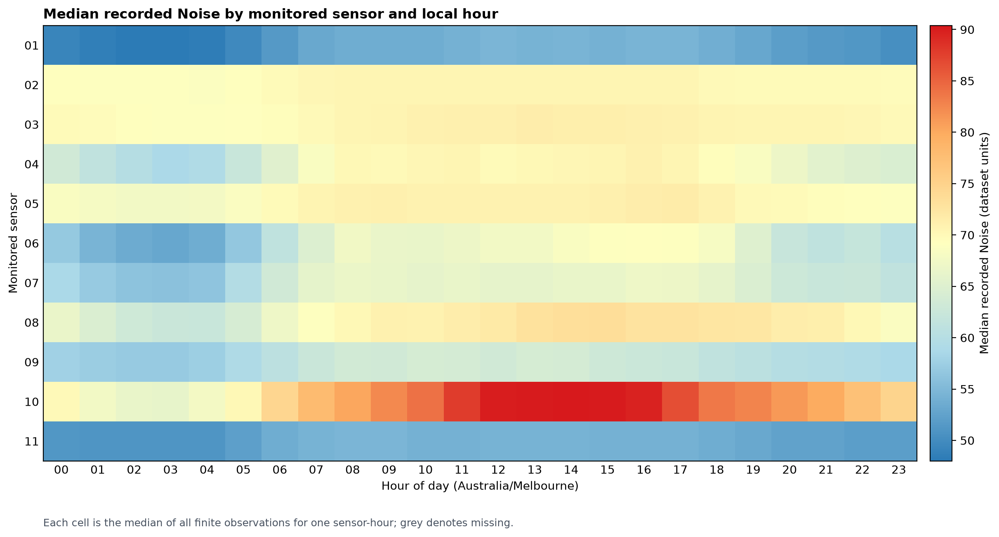{fig-alt="Heatmap of median recorded Noise for 11 sensors and 24 local hours."}

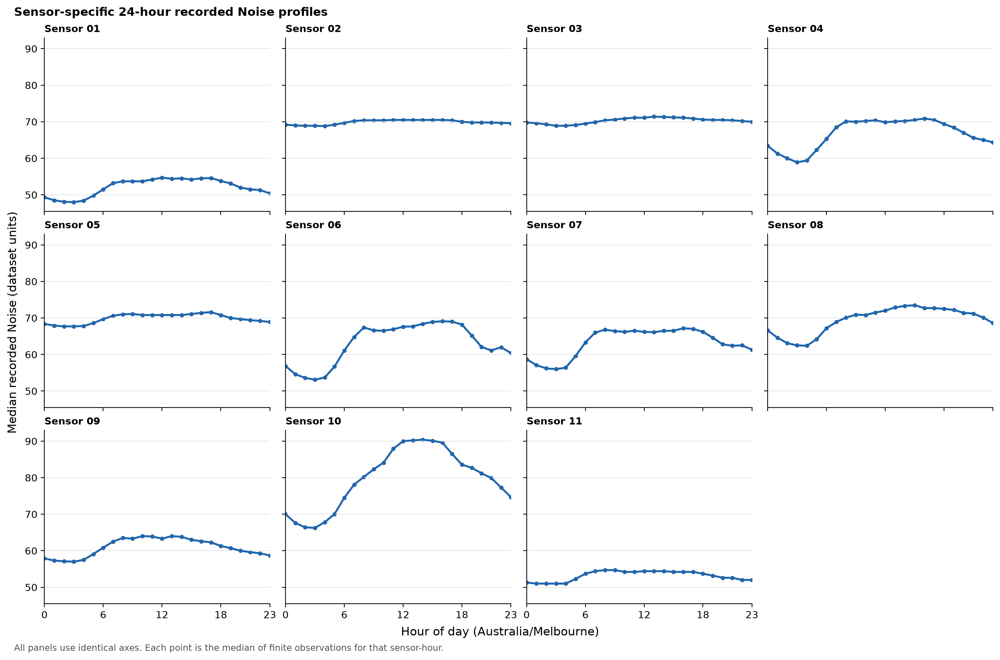{fig-alt="Eleven small-multiple hourly profiles using identical axes."}
:::

- Site medians range from **52.3 to 81.1** dataset units.
- Sensors 02 and 03 are comparatively flat; sensor 10 rises most strongly.

**Boundary:** location, calibration, mounting, siting and observation period remain mixed together.

::: {.notes}
Speaker: Xinlei. Target: 1 minute 10 seconds. Use the heatmap for comparison and the small multiples for shape. State the measurement limitation immediately after the finding.
:::

## Pedestrian activity does not give a stable answer

::: {.columns .compact-columns}
::: {.column width="62%"}
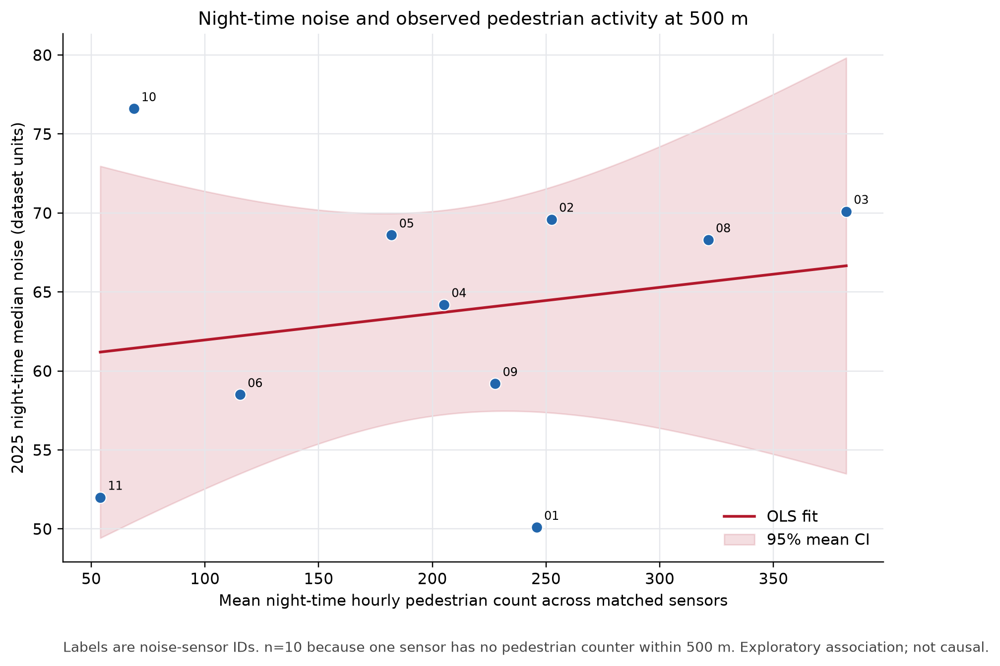{.slide-plot fig-alt="Scatter plot for ten matched sensor locations."}
:::

::: {.column width="35%"}
::: {.result-strip}
**ρ = 0.248**  
permutation **p = 0.494**  
**n = 10** at 500 m
:::

**Stability checks**

- Leave one site out: **0.067 to 0.583**.
- Across buffers: **−0.168 to 0.618**.

**Interpretation:** no stable simple association for this measure and sample.
:::
:::

::: {.notes}
Speaker: Xinlei. Target: 1 minute 10 seconds. Explain that changing buffers change the matched counters. Do not generalise this result to pedestrian activity and sound overall. Hand over to Chen.
:::

## A frozen screen and a separate follow-up

::: {.two-result-grid}
::: {.compact-result}
### Original screen

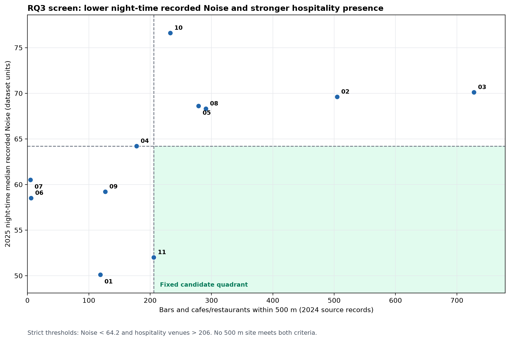{fig-alt="Scatter plot with fixed low-noise and high-hospitality median thresholds."}

Below **64.2** and above **206**: **0 candidates** at 500 m.
:::

::: {.compact-result}
### Exploratory follow-up

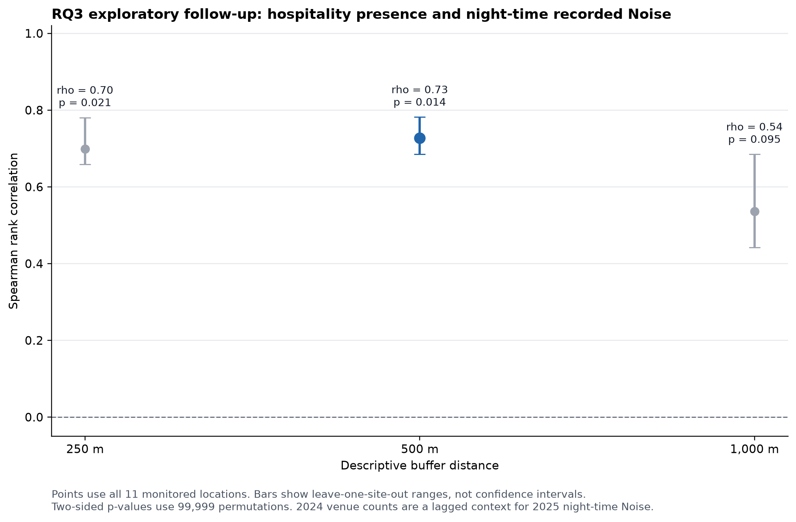{fig-alt="Spearman correlations and leave-one-site-out ranges at three buffer distances."}

500 m: **ρ = 0.727**, **p = 0.014**, **n = 11**.
:::
:::

We did not move the thresholds. The continuous follow-up is post-screen, exploratory and non-causal.

::: {.notes}
Speaker: Chen. Target: 1 minute 35 seconds. First preserve the zero-candidate screen. Then explain why using all ranks is more informative. State that the 2024 hospitality count is lagged context and that the positive follow-up does not establish causation.
:::

## Methods matched to a small sample

::: {.columns}
::: {.column width="49%"}
### What we used

- Medians
- Equal-sensor aggregation
- Spearman rank correlation
- 99,999-draw permutation tests
- Leave-one-site-out checks
- Three buffer distances
:::

::: {.column width="47%"}
### What this tests

- Unequal sensor coverage
- Strong distributional assumptions
- Dependence on one location
- Dependence on one buffer
- Stability, not causal effect
:::
:::

::: {.notes}
Speaker: Chen. Target: 1 minute 15 seconds. The analytical sample is 10 or 11 sites. Explain why a complex multivariable model would be less defensible, not more advanced.
:::

## What the project succeeded at and where it stops

1. A clear daily cycle appears across monitored sensors.
2. Sites differ in level and hourly shape.
3. The pedestrian result is unstable across reasonable checks.
4. The frozen hospitality screen selects no 500 m candidate.
5. A separate continuous follow-up is positive but exploratory.

::: {.caution-box}
Success means a reproducible and well-bounded answer. It does not mean a city-wide map, a causal model or a physical exposure measure.
:::

::: {.notes}
Speaker: Chen. Target: 1 minute 5 seconds. Treat this as a reflection on project success. Pause after the first two findings, then state the evidence boundary.
:::

## From one sparse network to better decisions

::: {.role-grid}
::: {.role-card}
**Sandhya**

Found the data and prepared a defensible sample.
:::
::: {.role-card}
**Xinlei**

Linked the data and turned the links into visuals.
:::
::: {.role-card}
**Chen**

Selected and explained methods for the small sample.
:::
:::

**Reproducibility:** retained snapshots, checksums, explicit joins, processed tables and a self-contained HTML presentation.

**Stronger evidence would require:** validated sensor metadata and a wider, more stable monitoring network.

::: {.final-message}
Sparse sensor data can guide better questions—if the evidence boundary stays visible.
:::

**Questions?**

::: {.notes}
Speaker: Chen. Target: 1 minute 5 seconds. Name every contribution, state what stronger evidence would require, and return to the broad decision problem from the opening. Total planned speech is about 12 minutes 30 seconds, leaving time for handoffs and natural pauses under the 15-minute limit.
:::

# Backup slides {.unnumbered}

## Seasonal sensitivity

::: {layout-ncol="2"}
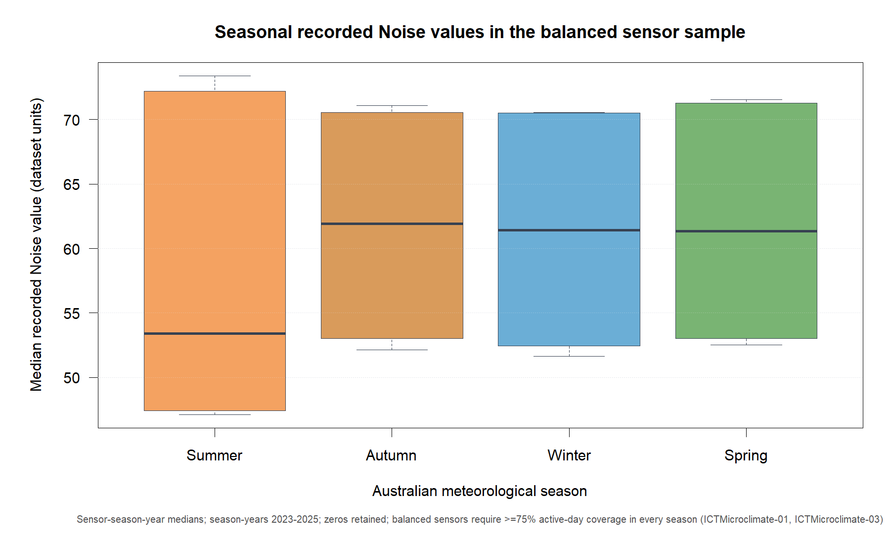{fig-alt="Boxplot of balanced sensor-season-year recorded Noise summaries."}

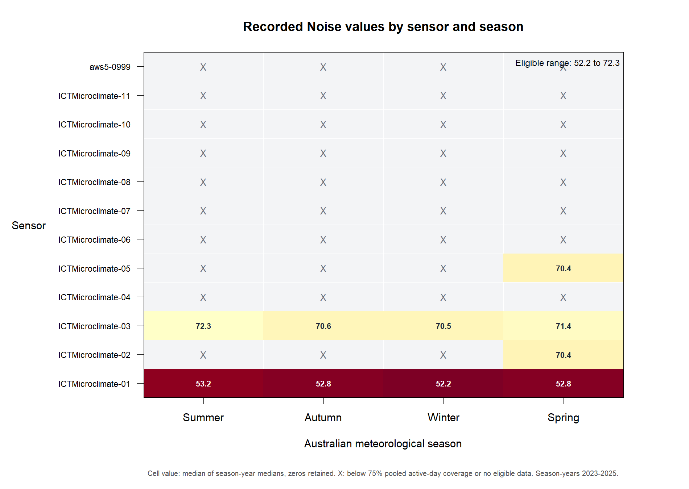{fig-alt="Heatmap of sensor seasonal medians with ineligible cells marked."}
:::

Only sensors 01 and 03 meet the 75% active-day rule in every pooled season. Seasonal ordering is therefore composition-sensitive.

## Pedestrian buffer sensitivity

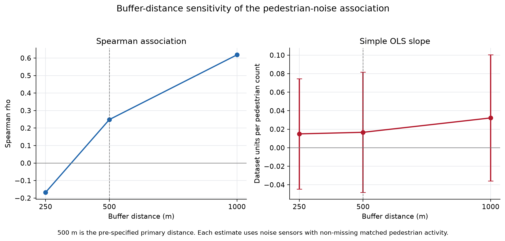{fig-alt="Pedestrian and recorded Noise association sensitivity across three buffers."}

The buffer results reuse the same Noise sites with changing counter sets. They are sensitivity checks, not independent samples.

## Reproducible workflow

```sh
python analysis/run_pipeline.py --check
python analysis/run_pipeline.py --run --overwrite
quarto render presentation/final_presentation.qmd
```

The pipeline validates pinned software, six source snapshots and checksums, required scripts, spatial joins, processed tables, figures and statistical outputs.
