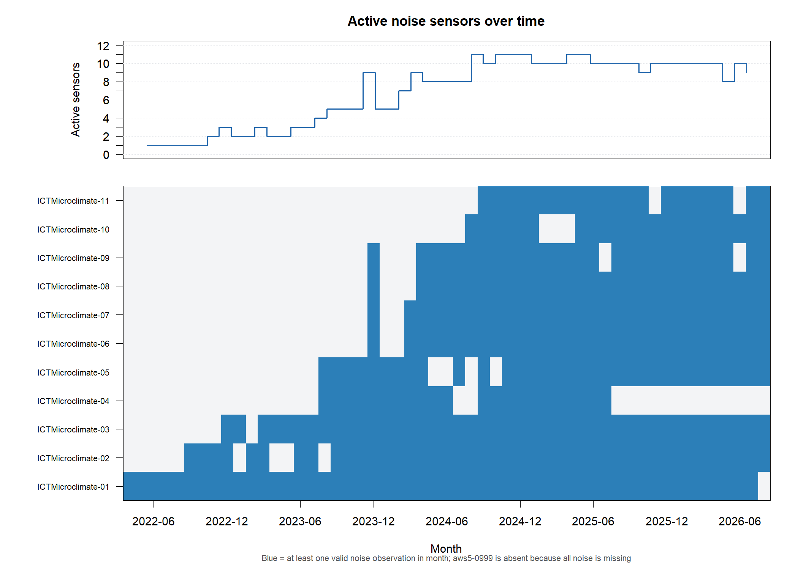
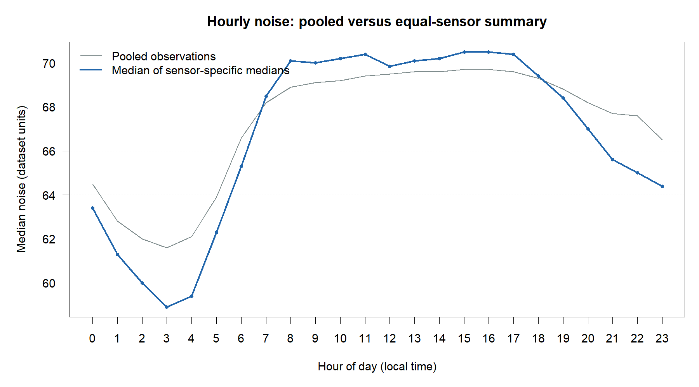
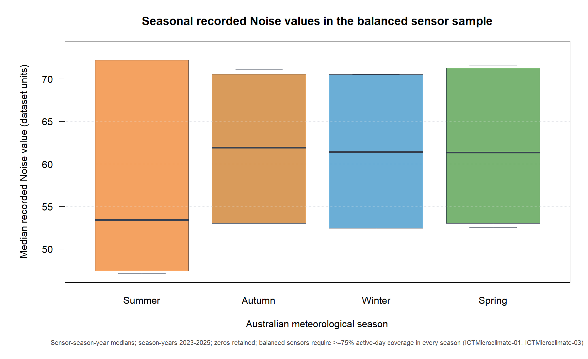
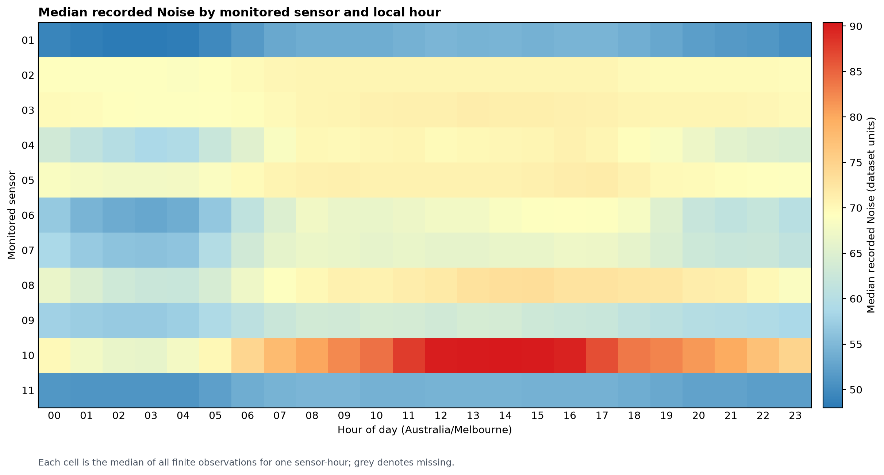
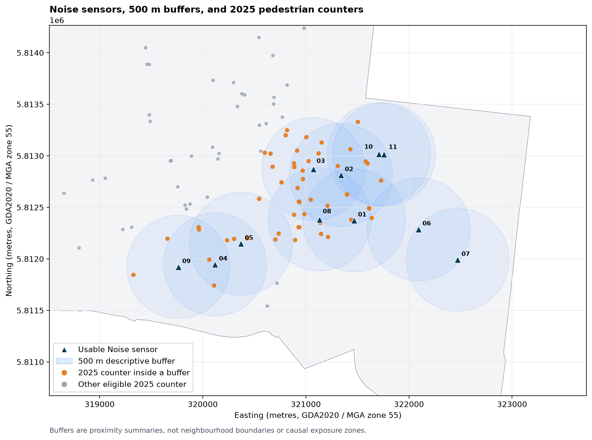
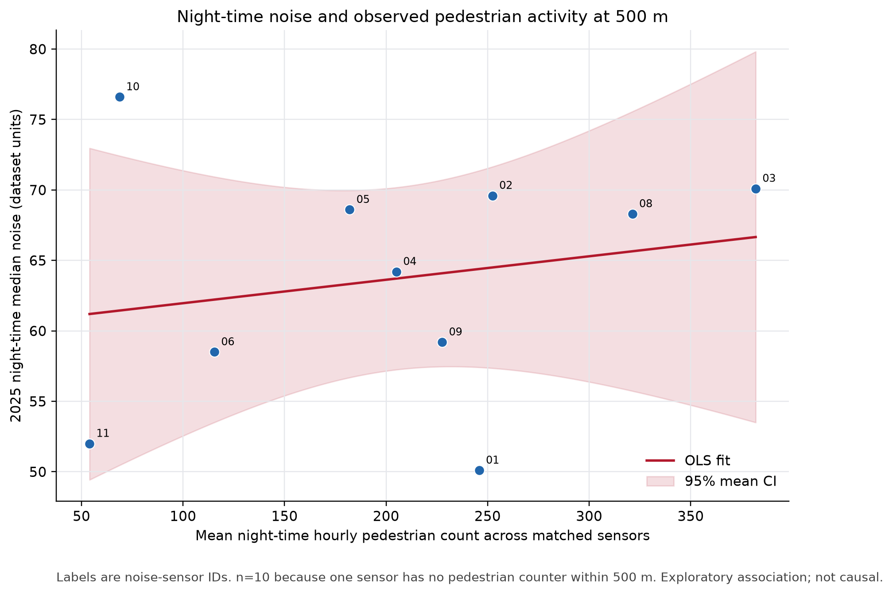
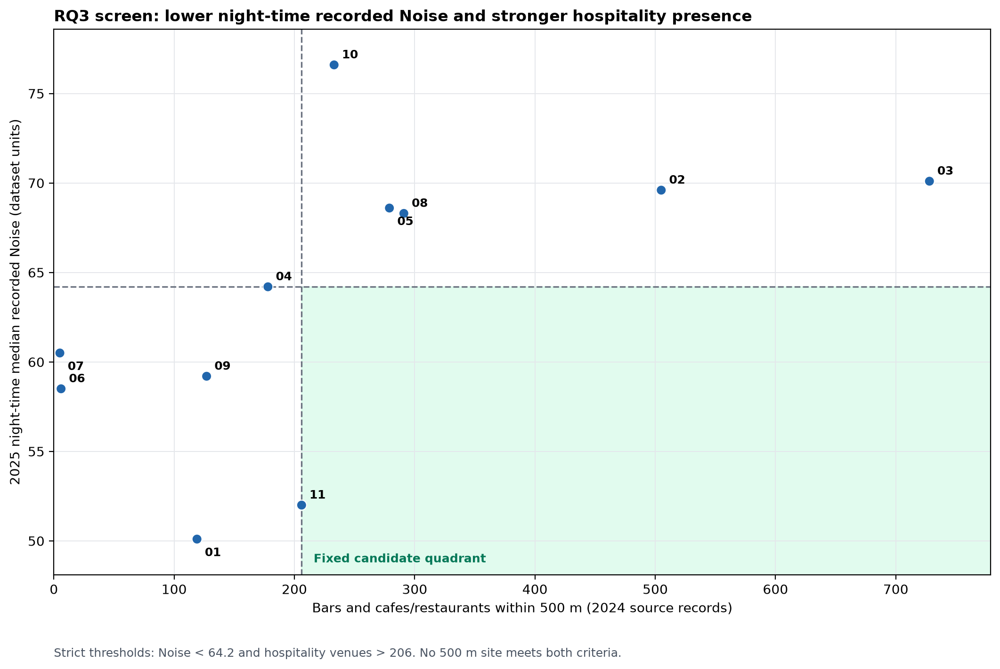
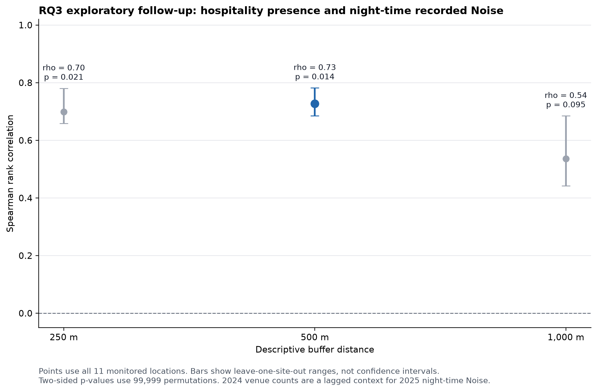

# Abstract {.unnumbered}

Data from urban sensors can show strong temporal and local pattern, and sparse monitoring networks can also lead to conclusions that the data do not support. This project examines the field called Noise in a microclimate snapshot retained by the City of Melbourne and correlates it with time and the monitored location, as well as pedestrian information and nearby hospitality records. Due to the lack of official metadata which would identify the physical unit, sensor model, calibration protocol or a noise-specific quality flag for this field, all results are reported as recorded Noise values in dataset units. The snapshot includes 975,550 records from 12 devices in the period from 31 May 2022 to 17 August 2026. 11 devices have 893,959 usable Noise values, while one device has no usable Noise observations. Medians, sensor-balanced summaries and coverage diagnostics and sensitivity analyses are used to minimize the impact of extreme values, unequal record numbers and evolving network composition. In GDA2020 MGA Zone 55, the spatial features are determined using a primary buffer of 500 m, and two sensitivity buffers of 250 m and 1,000 m.

The most obvious outcome is a diurnal pattern. The pooled hourly median increases from 61.6 at 03:00 to 69.7 at 15:00-16:00, and the median of the hourly medians of the sensors increases from 58.9 to 70.5. Differences for day of week are very small. Overall site medians vary from 52.3 to 81.1 but the effects of calibration, mounting, siting and observation period cannot be distinguished from the effects of location. Ten sites are connected to pedestrian counters at 500 m. The main correlation between 2025 night-time Noise and mean night-time pedestrian activity is the Spearman correlation coefficient 0.248 with a permutation p-value of 0.494, and leave-one-site-out estimates vary between 0.067 and 0.583. Thus, there is no stable simple association that is identified by the analysis. The documented hospitality screen selects no candidate at the primary 500 m distance. A subsequent exploratory rank analysis is positive at 500 m (rho = 0.727, permutation p = 0.014), but compares 2025 Noise with lagged 2024 venue counts, and is descriptive and non-causal. A cross-source overlap audit identified 166 venue keys in both of the hospitality source files. Their duplicate contribution is removed and the 500 m candidate result and rank correlation remain the same. The project shows that it is most useful to keep the uncertainty of measurements, the coverage and spatial scope visible in any conclusion, so that they can be reproduced.

# Introduction

## Background and motivation

The environment is subject to change on a short time scale and between close locations. Transport, construction, commercial activity, events, weather and street and building design may impact on what is recorded at a monitoring point. This variability is significant to consider, as repeated observations from a sensor can be useful to illustrate the variability of observations over hours, weekdays and seasons, while a short manual survey may not. Simultaneously, a sensor network is not necessarily a representative sample of a city. Only a few devices can provide a lot of data at their installation site and most neighbourhoods will not be observed. The main analytical issue is thus not just to compute summaries. It is to identify comparisons that are appropriate, assumptions that affect comparisons, and where interpretation stops.
The City of Melbourne defines its microclimate data as data collected from sensors within the City and that is updated every 15 minutes or so, but notes that there may be no data in some intervals (City of Melbourne, n.d.-a). This description can be used for temporal and coverage analysis. It does not necessarily mean that all variables can be considered as measures of regulatory exposure. The retained snapshot includes the Noise field, but the older official data dictionary does not document it. That dictionary provides units and expected ranges for temperature, humidity, pressure, particulate matter and wind (City of Melbourne, 2021). This omission matters. The number may seem like a familiar sound-level number, but it's not metadata, if it's close to 70. A label such as decibels alone, without an authoritative unit, frequency weighting, averaging interval, calibration record or instrument specification would yield precision that the source is not able to provide.

This measurement boundary is used throughout the entire report. The field name is exactly the same as what is written in the field (Noise), and phrases such as 'recorded Noise value' or 'dataset unit' are used in the interpretation of the results. The values are not compared to health or regulatory thresholds. However, the World Health Organization has demonstrated the importance of environmental-noise exposure to health policy for specific noise sources and exposure metrics, but not for an undocumented field with a similar numeric range (World Health Organization, 2018). It is important to distinguish between those two: The general significance of environmental noise does not justify a specific measurement.

The significance of metadata and deployment details is also demonstrated in technical literature. Acoustic sensor net-works can expand spatial and temporal coverage, but are only useful if the microphone performance, calibration, processing, maintenance, communications and environmental resilience are adequate (Picaut et al., 2020). In this project, the repeated readings are analytically useful, but the missing sensor model and mounting height and calibration history makes it impossible to identify differences as pure differences in local acoustic exposure. The devices are fixed, but fixed is not comparable without qualification.

The project was created with a repository name that is related to noise complaints. This current analysis is not a complaint study. It relies on instrument records, observations of pedestrian counters and Census of Land Use and Employment records. A complaint is a human report that is influenced by perception, expectations and reporting behaviour, an instrument output is a sensor value. Soundscape research also distinguishes physical acoustic conditions from how people perceive and evaluate an environment (Aletta et al., 2016). As a result, the report does not attempt to interpret the sensor field as a measure of annoyance, tranquillity, safety or preference for residential areas
.

## Research questions

The main question is:

> How do monitored urban Noise values vary across time and space in the City of Melbourne, and what characteristics of the surrounding urban environment are associated with these patterns?

The analysis is organised around three supporting questions:

1.  How do recorded Noise values vary by local hour, day of week and season at the monitored locations?
2.  Which monitored locations have the highest and lowest recorded values, and how do their hourly profiles differ?
3.  How are nearby pedestrian activity and hospitality presence related to differences in 2025 night-time recorded Noise, and how stable are those site-level relationships?

The third question involves two separate analyses. The pedestrian analysis estimates the primary association using 2025 counts. The hospitality analysis first applies a fixed descriptive screen for sites with below-median night-time Noise and above-median venue counts. Because no site meets both conditions at 500 m, a later exploratory rank analysis examines the same variables without changing the original screening rule.

An earlier proposal considered a multivariable contextual benchmark for identifying sites with unusually high or low recorded values. This analysis was deferred because only 11 usable Noise locations were available. With so few sites, a model containing several predictors would be highly sensitive to variable selection and individual observations. We therefore prioritised transparent summaries, simple associations and direct stability checks.

## Significance and contributions

This project makes four key contributions.

First, we structured a big and complex noise data set in results which are easier to understand and verify. Noise levels were analysed by hour, day, season and monitoring location. Patterns in fluctuations of noise throughout the day were identified, as were areas with higher sensor readings.

Secondly, we took into account the issue of varying data coverage from the sensors. There was variability in the amount of data collected by different sensors that may impact overall results. To deal with this, we compared results based on all observations with results that gave equal weight to each sensor. We also attempted to make the comparisons as fair as possible over the long-term and used graphs to illustrate how the number and location of the active sensors changed over time.

Third, we layered noise data with data on nearby pedestrian activity, bars and hospitality venues. A consistent co-ordinate system was used and areas within 250, 500 and 1000 metres of each sensor were examined. This enabled us to investigate if there were any relationship between the levels of noise and activities in the vicinity.

Fourth, we explicitly stated the uncertainty and limitations of our results. We were more interested in how the entire research process was conducted, and whether it was clear, reliable and reproducible. All steps, from the original data to the checks of data and to the final conclusions were documented. We also made it clear what the data could support and what it could not.

Another significant contribution of this project is that results are still valuable even if we do not find a clear relationship or if the results are unstable.

For example: 

- If we had no candidates that met our original selection criteria, we reported this result and did not adjust the criteria to find something. 

- If an association had a smaller p-value at one buffer distance but changed noticeably at another distance, we reported that instability rather than highlighting only the most statistically significant result. 

-When a positive correlation between activities and noise level was identified near the activity, it was reported as an associ-ation. But we didn't say that these activities led to increased noise levels, as correlation is not causation. 

These choices help to ensure that our research is credible; we did not alter our methods to obtain the results we desired and we did not make claims that were not supported by the data.

This report is primarily for those who know a bit about data analysis but are not familiar with our project. Hence, we try to present our research procedure, results and limitations in a lucid and understandable manner.

## Git repository of the report

<https://github.com/XINLEI-LUO/ETC5543_noise_complaints>.

# Data

## Data sources

### Microclimate sensor snapshot

The primary input data is a snapshot of the City of Melbourne microclimate sensor data, which was retained as `data/raw/microclimate_sensors.csv`. The local file is 163,912,284 bytes and has SHA-256 checksum `85f784a66356cbc0eba0793d95faec8801627baf03485a3a15fb17c74e03eb01`. The snapshot covers 31 May 2022 to 17 August 2026 and contains 975,550 rows. The official portal states that the dataset consists of “around 15 minutes of climate readings” and that there may be gaps in the readings for some periods (City of Melbourne, n.d.-a). The repository holds the exact large snapshot as a GitHub Release asset as this is bigger than the normal GitHub limit per file.

The source contains 12 device identifiers, 11 location labels and 12 coordinate pairs. Eleven ICTMicroclimate devices contain finite Noise values. The device aws5-0999 has 65,847 rows, but all its Noise values are missing, so it is excluded from outcome aggregation. The 11 usable devices contribute 893,959 finite observations. Recorded zeros remain in the primary analysis because their meaning is not documented.

Historical sensor-location metadata indicates that the location of the sensors may change and location is important for interpretation of historical observations (City of Melbourne, n.d.-b). The project snapshot embeds device, location and coordinate fields, and all usable devices have one complete coordinate pair within the snapshot. However, the external warning further reinforces the importance of considering installation history as a potential source of uncertainty. There are two devices, `ICTMicroclimate-10` and `ICTMicroclimate-11`, share the label `1 Treasury Place` but have distinct coordinates and very different recorded levels. Thus, the primary key is not the location label, but the device identifier.

### Pedestrian activity data

Pedestrian activity comes from `data/raw/pedestrian_counts_2019_2024.csv` and the corresponding sensor-location file. The historical file names are misleading: the counts kept are for 19 August 2024 through 15 August 2026. Each row in the City portal represents a one hour count of pedestrians and the location key should be linked to the sensor-location data, with the warning that location changes will impact on interpretation over time (City of Melbourne, n.d.-c). The location metadata shows that the system tracks movement across counting zones, and not images or unique individuals (City of Melbourne, n.d.-d).

The retained file contains 286,845 hourly rows in 2024, 815,447 in 2025 and only 166 in 2026. The main pedestrian-analysis year is 2025, as 2024 is partial and 2026 is too sparse. This analysis does not assume that the counts are unique individuals. A counter can be passed more than once by a person and multiple counters in a buffer can see related flows. This can also vary depending on the weather, events, transport conditions, holidays and outages.

### Hospitality and business context

Hospitality context is created from the 2024 CLUE bar and cafe sources. The bar file includes venue records and the patron capacity, while the cafe file includes venue records with both indoor and outdoor seating. A wider business-establishment file provides ANZSIC classifications and locations. The City notes that the number of businesses established in a CLUE is not necessarily an indication of the number of enterprises, since the same enterprise may have more than one location (City of Melbourne, n.d.-e). It is important to note that for the purposes of this report, the term `hospitality_venues_2024`  refers to the number of source records that are close to a sensor, rather than the number of corporate owners, visits or customer experiences or open venues at a given time.

The 2024 subset of the broader establishment file contains 19,672 records, including 14,337 active-business records and 5,335 `Vacant Space` records. The specialised bar source has 304 valid 2024 venue records, while the cafe source yields 2,248 records after the project deduplication rule. City metadata describes the cafe data as CLUE records with trading name, address, ANZSIC classification, seating type and seats (City of Melbourne, n.d.-f). The specialised sources support counts and capacity summaries, the broader file supports business-mix descriptions. The primary hospitality proxy adds the bar-source and cafe-source record counts. It is therefore a sum of records from two source categories, rather than a guaranteed count of unique physical venues across both files.
A sensitivity analysis was performed, and a later cross-source audit revealed that there were 166 matching venue keys.

### Spatial reference data

The municipal boundary is a GeoJSON retained by the City of Melbourne and has a coordinate CSV derived for the base R map. The sensor and activity coordinates are input as longitude and latitude in WGS84. All metric distances are based on distances transformed to GDA2020 MGA Zone 55, EPSG:7855. The `sf` package implements standard simple-feature geometry and connects R to established spatial libraries for reading, transformation and geometric operations (Pebesma, 2018). The projected system is suitable for metre operations in central Melbourne. Buffers are not neighbourhood boundaries, but summaries of proximity in a circular buffer.

## Data structure and coverage

The raw Noise snapshot is a repeated measures data set. Each row represents an observation from a device at a time, NOT an independent location. Taking each of the 893,959 finite records as a separate spatial unit would yield a false precision. Records can be used for temporal summaries, spatial associations can be done using one row per Noise sensor and buffer distance.

Observations are recorded at approximately 15-minute intervals. The median positive gap is approximately 15.02 to 15.27 minutes, with 92.2% to 99.7% of the positive gaps being between 12 and 18 minutes across the 11 usable devices. Gaps and outages still exist. There is a significant difference in the usable period for the various sensors: sensor 01 begins in May 2022, sensors 10 and 11 begin in August 2024, and sensor 04 ends in July 2025. The number of usable sensors contributing in a month ranges from one to 11. This change in composition can be seen in @fig-coverage.

Coverages are reported at the hour and day level. The nominal number of observations is 4 for an hour and 96 for a day. The operational ratio is based on unique finite timestamps divided by the expectation, and is capped at one, meaning that no duplicated rows can make an hour or a day look more complete. Of 228,241 sensor-hours, 215,497 (94.42%) meet the unique-timestamp hourly rule. Of 9,596 sensor-days, 5,678 (59.17%) meet the daily rule. The day denominator is deliberately simple and does not change to 92 or 100 on daylight-saving transition days. Coverage thus is a diagnostic and not evidence of the presence of all scheduled records.

{#fig-coverage fig-alt="Line and tile plot showing changes in the number and identity of usable Noise sensors from 2022 to 2026." width="95%"}

## Data quality and cleaning decisions

No exact duplicated full rows were found, but 2,745 device-timestamp groups have repeated timestamps, which is 2,751 more rows than one per key. Most repeated device-timestamp groups contain conflicting Noise values rather than identical repeated observations. The maximum finite difference within the same timestamp is 40.0 dataset units for sensor 08, which also has the most repeated groups. Location and coordinates are not changing over repeated keys; the rows seem to be different source observations with the same timestamp. The source doesn't include an ingestion identifier to identify the authoritative record.

All duplicate rows are kept in the primary analysis. A sensitivity version replaces all conflicting finite values within a repeated device-timestamp group with the median of the values and leaves all-missing groups as missing and preserves one value in a repeated group where all the values are the same. In 55 comparisons of the outcomes from the sensors, 53 are the same and 2 are different by 0.1 dataset unit. This outcome can be used to support the retention of the source records and to document the ambiguity.

There are 649 recorded zeros among 893,959 finite Noise observations, or 0.0726%. Most occur in 2026, and 435 occur at sensor 08. Zeros in the primary estimates are kept. A parallel zero-excluded analysis changes hourly and sensor medians by no more than 0.1 dataset unit, leaves the sensor ordering unchanged and leaves the reported 500 m association estimates unchanged to six decimal places. The sensitivity analysis shows that the reported conclusions are robust to excluding zeros in this snapshot. It does not establish whether the zeros are measurement errors.

Extreme observations are also kept. The median of the pooled Noise distribution is 67.9, with the first quartile at 58.5 and the third quartile at 71.6, and a range of 0.0 to 131.1. A 1.5-IQR rule flags 25,989 values, but a statistical outlier rule cannot determine whether a sensor reading is faulty. Removing these observations without instrument metadata could discard genuine events. Typical-value summaries are created using medians, which allow the extremes to have less effect on the overall picture, but do not imply that they are "faults".

@tbl-data summarises the analytical data layers.

| Layer | Primary period | Unit of analysis | Role in report | Main limitation |
|---------------|---------------|---------------|---------------|---------------|
| Microclimate Noise | 31 May 2022 to 17 Aug 2026 | Repeated device timestamp | Temporal and site outcomes | Physical unit and calibration unconfirmed |
| Pedestrian counts | Calendar year 2025 | Counter hour then sensor buffer | Night-time activity association | Movements are not unique people |
| CLUE hospitality | Census year 2024 | Venue source record then sensor buffer | Lagged hospitality context | Locations are not realised visits or 2025 exposure |
| Municipal boundary | Retained snapshot | Polygon | Map context | Not an analytical neighbourhood boundary |

: Analytical data layers and limitations {#tbl-data}

# Methodology

## Analysis principles

We have five basic principles for our data analysis.

**First, all results need to be traceable.** Each result should be linked to the original data, analysis code and saved output files so that others can check and reproduce the analysis.

**Second, we select the suitable method to analyse the data according to various research questions.** For instance, repeated noise measurements are used when studying the change in noise levels over time. In comparing noise levels between sensors, the data is first summarised for each sensor to prevent sensors with a large number of records dominating the results. For the study of noise and activities in the vicinity of the sensor, one summary record is used per sensor.

**Third, we mainly use medians to summarise noise levels.** This is because medians are not as sensitive to a few very high or low noise values as are means and are therefore more appropriate for displaying typical noise levels.

**Fourth, we use sensitivity analysis to check whether our results are stable.** For instance, if we are not sure how to treat some data, we experiment with other sensible approaches to determine if the conclusions vary. But we do not alter the original data or methods in our primary analysis in secret.

**Fifth, we don't exaggerate our results.** All our findings are only relevant to the areas and time periods we have actually covered in our project. The results cannot be assumed to be applicable to the entire Melbourne, other regions or other time periods.

The primary pipeline is a mixture of R and Python. R does Noise exploratory analysis, coverage summaries, seasonal aggregation, sensor outcomes, spatial buffers, CLUE features and validation. Python performs pedes-trian preparation, statistical associations, final presentation outputs and the exploratory hospitality follow-up. The locked R environment records R 4.5.2 and direct packages including `dplyr`, `tidyr`, `readr`, `sf` and `ggplot2`. The Python manifest targets Python 3.12.14 with pinned versions of `pandas`, `numpy`, `scipy`, `statsmodels`, `matplotlib`, `pyproj` and supporting packages. Graphical output follows the layered grammar implemented in `ggplot2` where R is used (Wickham, 2016), while the Python figures are generated with Matplotlib.

## Temporal summaries

Pooled hourly summary: This is a summary of all finite observations grouped by local hour and the median value is taken. The sensor-balanced hourly summary is determined in two steps:

1.  for each device and local hour, calculate the median of its finite Noise values;
2.  for each hour, calculate the median of the 11 device-specific medians.

In the second stage, all the devices that can be used are given the same weight, irrespective of the number of records they have. The weekdays are ordered Monday to Sunday and the same two stage process is used. Pooled and balanced curves are presented together because the shape of the curves is more convincing when they agree. The differences between the curves indicate the impact of network composition and unequal numbers of records.

The common period of the three sensors: 01, 02 and 03 is used for the calculation of a long term weekly sensitivity from 1 January 2023 to 30 June 2026. Only a week is kept if all three devices contribute. Each sensor can compute the medians for each week and then combine them together, so that one sensor doesn't overwhelm the others by sampling more often. Correlation and median absolute difference are used to compare the balanced and original pooled weekly series. This analysis does not aim to give a trend throughout Melbourne, but rather to determine whether any broad trends exist following a single reasonable composition control.

## Seasonal summaries

Meteorological seasons in Australia are summer (December, January, February), autumn (March, April, May), winter (June, July, August) and spring (September, October, November). December is allocated to the next season-year, thus summer 2024 includes December 2023, January and February 2024. Full season years 2023-2025 are the basis for the main season window. The four-season comparison does not include partial records from 2022 and 2026.

Seasonal aggregation is hierarchical in nature. The daily median is calculated and then the seasonal median is calculated to make fair comparisons between noise levels in different seasons. This prevents sensors with more recorded data from having too much influence on the overall results.

We have applied balanced analysis in our analysis to make the comparisons between different years and seasons more equitable. At least 75% of the expected days in each season of the comparison period (2023-2025) must have valid noise data for each sensor.

According to this rule, only sensors 01 and 03 satisfy the requirement, and our main balanced analysis only considers these two sensors.

In addition, we conduct sensitivity analysis by lowering the data coverage requirement from 75% to 50%. This will enable us to add sensor 02 and see if our findings are consistent.

## Site-level and sensor-hour analysis

The site table provides the overall median, number of finite observations, number of active days, first observation and last observation for each usable device. A sensor-by-hour matrix is a matrix of the median value for each of 11 devices and each hour of the day. One common colour scale is used for the heatmap and identical axes are used for the small-multiple profiles. These restrictions allow for direct comparisons. Independent panel scales would make all devices appear the same and would mask level differences.

Comparisons of sites are descriptive. Local sound, installation, calibration, shielding, mounting height, device response, observation period, and activity in the vicinity may account for the difference between two devices. No duplicated co-located instruments or calibration checks have been made to isolate these components in the analysis.

## Spatial integration

Before distance calculations are made, noise locations, pedestrian counters and CLUE points are converted from EPSG:4326 to EPSG:7855. For each usable Noise device, there is a circular buffer of 250 m, 500 m and 1,000 m. The main pragmatic midpoint is the distance of 500 m, as we noticed, the 250 m distance is sometimes too small for pedestrian counters and the 1,000 m distance is more general in the central city context. No established acoustic mechanism uniquely justifies the 500 m radius, so we also examine results at 250 m and 1,000 m. This includes a point on the buffer boundary. Buffers can overlap; a pedestrian counter or venue could be included in more than one Noise site. That reuse is not a duplicate source record, but a spatial relationship.

The spatial key is `device_id + buffer_m`. Automated checks involve exactly 33 keys, 11 devices at each distance, no duplicate keys, plausible coordinates, non-negative counts and non-decreasing cumulative feature counts as distance increases. Zero means that the source loaded and no matching record was found. Missing means that there is no input or defensible calculation. This distinction prevents a failed join from being interpreted as a valid zero count.

The primary map shows all 11 usable Noise sites, 500 m buffers and pedestrian counters with valid coordinates in the 2025 count file. The map distinguishes counters inside at least one buffer from other eligible counters in the displayed extent. This is by design as the map does not represent a continuous Noise surface. If 11 central locations were interpolated, then coverage between and beyond sensors would be assumed.

## Pedestrian activity association

We use data from 2025 and define night-time as 6:00 PM to 5:59 AM the next morning.

The median night-time noise level is first computed for each noise sensor. Next, we gather pedestrian count data within 250, 500 and 1000 metres of each sensor.

We mainly use average pedestrian counts to study their relationship with noise levels. In particular, the average number of pedestrians per hour at night is first computed for each pedestrian counter. Next, we sum these averages for all counters that are eligible in the same buffer and divide by the number of counters. Each counter is given equal weight in this process, meaning that counters with more data recorded do not have a greater influence on the final result.

In addition to calculating the average, we also sum the average pedestrian counts for all counters in each buffer. We use this as an additional measure of pedestrian activity. This total, however, does not reflect the number of unique pedestrians as the same pedestrian could be counted at more than one location. For instance, a person passing by counter A and then counter B could be counted twice.

Hence, this measure is only indicative of the overall pedestrian activity in the surrounding area. It should not be interpreted as the actual number of unique pedestrians.

At 500 m, ten Noise devices have at least one matched pedestrian counter. Spearman rank correlation is the primary association measure because the sample is small, the variables are skewed and the question concerns whether site rankings move together. It does not require a linear relationship, although it remains affected by small sample size, ties and spatial dependence. Pearson correlation and an ordinary least squares line are reported as supplementary analyses. The shaded region is a 95% confidence band for the fitted mean, not a prediction interval or an uncertainty interval for Spearman’s rho.

Two-sided permutation p-value is calculated using 99,999 random shuffles with a fixed seed. The Noise values are fixed and the pedestrian values are shuffled between sites; the absolute shuffled rank correlations are compared to the absolute observed correlation. The plus one in the numerator and denominator avoids a zero Monte Carlo p-value. Permutation inference also requires exchangeability of the site labels under the null. The p-value is supporting evidence and nearby sites and overlapping buffers may not be perfectly independent.

Leave-one-site-out analysis recalculates Spearman correlation and the simple OLS slope after omitting each site in turn. The resulting range is not a confidence interval. It shows how sensitive the estimates are to individual monitored sites. Buffer sensitivity repeats the main analysis at 250 m and 1,000 m. These results are not independent replications because they reuse Noise devices with different matched counter sets.

## Hospitality screen and exploratory follow-up

For this aspect of our research, we are primarily interested in: **Are there any locations where there are many bars and cafés nearby, but night-time noise levels are relatively low?**

**First**, we prepare the data. There are two types of data that we use:

-   **Noise data:** The median noise level for each sensor during night-time (6:00 PM to 5:59 AM the following day) in 2025.

-   **Nearby venue data:** The number of bars and cafés around each sensor in 2024. We sum these two numbers and use the sum as a simple measure of nearby hospitality activity.

The calculation is: `hospitality_venues_2024 = n_bars_2024_baseline + n_cafes_2024_baseline`

In simple terms, **the total number of nearby hospitality venues equals the number of bars plus the number of cafés.** Finally, all 11 usable noise sensors have the necessary data for this analysis.

**Second**, we set screening criteria to find suitable locations.

We would like to find places **where there are a relatively high number of bars and cafes in the area, but relatively low noise levels at night.** So a site should have two criteria:

1.  Its night-time noise level must be **strictly below the median noise level across all sensors**.

2.  Its total number of nearby bars and cafés must be **strictly above the median venue count across all sensors**.

Note that if a number is exactly equal to the median, it is not acceptable. These criteria are applied independently in 250-metre, 500-metre and 1000-metre buffers. The thresholds are based on the data for each buffer distance. These thresholds are merely used to help us identify and compare locations. They are not saying that the median is the only scientifically correct threshold.

**Most importantly, we don't alter our screening criteria because we don't like the results.**

**Third**, the key screening findings within 500 metres are discussed.

The 500-metre buffer is our main analysis distance. For this buffer, we set two requirements:

-   The median night-time noise level must be **below 64.2**.

-   The total number of nearby bars and cafés must be **above 206**.

To be selected as a candidate, a location must meet both conditions. It is important to note that **this screening process is not a statistical hypothesis test**. It's just a method of finding a location according to our criteria. The end result is that **no location meets both conditions at the same time.** We report this result as it is, not to reduce the requirements or change the thresholds simply to find suitable locations.

**Fourth**, due to the lack of suitable locations, we perform an exploratory analysis.

The first screening did not find any suitable locations, but we would still like to investigate another question: **Do locations with more nearby bars and cafés also tend to have higher night-time noise levels?**

To investigate this, we add an exploratory correlation analysis. Specifically, we carry out three steps：

**1. We calculate Spearman correlation coefficients.**

We explore the correlation between the number of bars and cafés in the 250m, 500m and 1000m buffers and the level of noise at night. In other words, we want to determine if there is a correlation between the number of bars and cafés in an area and the noise level in that area. But even if we do find a correlation, it doesn't always mean that these venues are directly responsible for increased noise levels.

**2. We estimate a two-sided permutation p-value using 99,999 random shuffles.**

We randomly reassign the pairing between site-level Noise summaries and hospitality counts 99,999 times and recalculate Spearman correlation after each shuffle. The two-sided p-value compares the absolute observed correlation with the absolute shuffled correlations, using the plus-one correction. A fixed random seed allows the calculation to be reproduced.

**3. We conduct leave-one-site-out analysis.**

We take out one sensor at a time and re-compute the correlation coefficient. For example, we take out sensor 01 and calculate the correlation again. We then take out sensor 02 and repeat the process, until all sensors have been removed once. Finally, the range of the resulting correlation coefficients is analyzed. The idea is to see **if our results are overly reliant on one sensor.** If a large change in the correlation occurs when one sensor is removed, then the result may not be very stable.

**Fifth**, we make clear the limitations of this analysis. There are two important points to consider.

**1. we added the exploratory analysis only after seeing the initial screening results.**

We specifically say that it is a **post-screen exploratory analysis**, not a formal hypothesis test that was designed in advance.

**2. Data for bar and café is 2024 and data for noise is 2025.**

This means that the two sets of data are not for the same year. The number of venues in 2024 may not be a complete reflection of the situation in 2025. Hence, caution should be exercised in the interpretation of the relationship between proximity of hospitality establishments and noise levels.

## Reproducibility and validation

The command `python analysis/run_pipeline.py --check` checks the software versions, required scripts, source files and checksums without replacing outputs. The full regeneration command needs to be given with the `--run --overwrite` flag. This ensures that generated files are not accidentally overwritten.

The report is based on saved outputs that can be correlated to the current local pipeline. Legacy scripts and out-of-scope population or biodiversity files are not included. The final PDF is rendered from this Quarto source, and its figures are referenced by repository-relative paths. Word counts, source traceability, citation audit and quality review are separate deliverables to allow for checking of narrative, project evidence and external literature separately.

# Results

## Network coverage and data quality

The retained snapshot is large, but data coverage is uneven across devices and time. It has 975,550 rows, with 893,959 rows containing finite values for Noise. The missing proportion is 8.36% but is concentrated and not uniform. The excluded `aws5-0999` device has 65,847 missing Noise rows, as all of its rows are missing the field. The highest missing rate is sensor 01 at 10.52% and all other ICT devices are less than 0.63% missing. If the overall missing rate were assumed to be the same for all sensors, this structure would be masked.

The active network expands with time. Only sensor 01 contributes at the beginning of the snapshot. There is a 157 calendar day gap between the initial observations and sensors are gradually introduced in 2023 and 2024. The number of active sensors eventually increases to 11, but decreases during outages and when sensor 04 stops. @fig-coverage clearly shows that a pooled time series is not a fixed set of locations. Any apparent long-term change is a combination of changes within sensors and changes in which sensors are present.

Completeness is dependent on the time scale. 94.42% of the sensor-hours meet the hourly rule, enabling hour-of-day analysis. Only 59.17% of the sensor-days satisfy the simple 96-unique-reading rule. A daily series can be informative but the completeness flag should be checked. Seasonal analysis is more challenging because it requires multiple days over multiple years and the balanced seasonal sample is very small.

Repeated timestamps are rare in comparison to the entire data set but can be detected in analysis. There are no exact duplicated raw rows. In most cases, the 2,745 repeated device-timestamp groups have different meteorological or Noise states. Median-based outcomes are almost unchanged when these groups are collapsed in the sensitivity dataset. The maximum difference in the outcome is 0.1 dataset unit and only impacts the weekend median for sensor 08 and the overall median for sensor 09. This check helps to make the decision to keep the source records and to not delete the repeated timestamps as an ingestion characteristic.

The same conclusion is obtained from zero-value sensitivity. The deletion of 649 zero observations results in a maximum change of 0.1 in the largest hourly or sensor median, no change in the ordering of the sensors, and no change in the principal spatial association estimates to the displayed precision. The small effect is due to the fact that the frequency of zeros is very low. Importantly, these summaries are robust, not evidence about what a zero means.

## Hour-of-day and weekday patterns

The most pronounced temporal trend is on a diurnal scale. The pooled median drops from 64.5 at midnight to 61.6 at 03:00, and quickly increases after 05:00. It reaches 68.2 at 07:00, is close to 69 through the working day and peaks at 69.7 at both 15:00 and 16:00. It then drops through the evening to 66.5 at 23:00. The difference between the peaks and troughs for the pooled data is 8.1 dataset units.

The sensor-balanced curve is similar in shape, but with a higher contrast. Its median of sensor-specific medians is 63.4 at midnight, 58.9 at 03:00 and 70.5 at 15:00 and 16:00. The peak-to-trough difference in the sensor-balanced summary is 11.6 dataset units. The greatest hourly difference between pooled and balanced summaries is 2.7. This is because the different levels and numbers of observations from the sensors contribute differently to the pooled series. It is more important to agree on the timing of the minimum, morning rise, daytime plateau and evening decline than the precise separation between the lines.

{#fig-hourly fig-alt="Two line series showing recorded Noise lowest near 03:00 and highest in the afternoon." width="95%"}

There are smaller differences on weekdays. The medians for the week vary from 67.3 on Sunday to 68.3 on Friday. Monday is 67.8, Tuesday 68.0, Wednesday and Thursday 68.2, and Saturday 67.8. The equal-sensor summary also notes that Friday was the highest and Sunday the lowest, but the gap is larger: 65.2 on Sunday, and 67.95 on Friday. The pooled difference for Friday-Sunday is 1.0, which is much less than the pooled difference for the hours of the day (8.1) and far less than the difference between the lowest and highest site medians (28.8).

Different questions are answered by these comparisons. The hourly curves are similar, indicating that the overall daily pattern is not only due to the different number of observations made by the various sensors. The weekday pattern suggests that there is not much separation between named days in a simple unadjusted summary. It does not mean that weekdays are the same and it does not account for holidays, events, weather or seasonal composition. The main report consequently accords greater interpretive significance to the hour of day.

The balanced weekly sensitivity for sensors 01, 02 and 03, is 148 complete weeks from January 2023 to June 2026. It has a correlation of 0.82 with the original pooled weekly series, and a median absolute difference of 1.4 units of the dataset. These three early devices are equally weighted, with broad movements surviving, but with varying local peaks and levels. This finding indicates that the use of time trends in the network should be made with caution and that the pooled line is not a city-wide index.

## Seasonal pattern

All available seasonal medians are: 66.80 for summer, 67.40 for autumn, 69.43 for winter and 68.72 for spring. The difference between winter and summer is greatest, 2.63 dataset units. These medians and their ranking will not change under zero exclusion. Only this summary would be tempting to talk of a stable winter maximum.
The coverage-balanced analyses demonstrate why this is an overstatement. Since different sets of sensors are used in these summaries, discrepancies among them are due to both seasonal trends and variations in the specific sensors used. Sensors 01 and 03 are the only ones that meet the 75% active-day threshold in all pooled seasons. Their medians are 53.41 in summer, 61.93 in autumn, 61.43 in winter and 61.35 in spring. The highest is in the autumn, not the winter. The ordering is again winter, spring, autumn and summer at the 50% threshold, where sensor 02 is also qualified. The lowest season is summer, under all three summaries, while the highest season and the absolute levels depend on which sensors qualify.

{#fig-season fig-alt="Boxplots of sensor-season-year medians for four Australian meteorological seasons." width="90%"}

The difference between the all-available and 75% balanced seasonal medians reaches 13.39 dataset units. That difference is much greater than the all available seasonal range of 2.63, and this shows that network composition is more important than the apparent seasonal difference. Seasonal evidence is therefore a supporting result. It is not a general seasonal effect over Melbourne, but rather describes the monitored devices that meet each of the coverage rules.

## Differences between monitored sites

The medians for the overall values are highly variable between the 11 useable devices. The lowest median is 52.3 at Birrarung Marr Park (sensor 01). Next is at 53.4 at one of the Treasury Place coordinates with sensor 11. The medians are 60.6 for sensor 09 at MCEC rooftop, 63.0 for sensor 06 near Melbourne Tennis Centre, 63.6 for sensor 07 near Melbourne Tennis Centre and 67.0 for sensor 04 at Batman Park. Sensors 05, 08, 02 and 03 cluster from 69.7 to 70.2. The highest median is 81.1 for sensor 10 at the other coordinate of Treasury Place.

The heatmap of the sensor-hours shows that the site range (28.8 dataset units) is visually dominant. Sensor 10 is in the upper 60s in the early morning, and then around 90 for most of the day. Sensors 02 and 03 are relatively flat at ~70. Sensor 01 is still low throughout all hours but still exhibits a daytime rise. The early morning lows and daytime rises are more distinct on sensors 06, 07 and 09. Although sensor 11 is in close proximity to sensor 10, it is low throughout. Both level and shape can be seen on the common colour scale.

{#fig-heatmap fig-alt="Heatmap with 11 sensor rows and 24 hourly columns showing large level differences and varied daily profiles." width="100%"}

It is particularly instructive to compare sensors 10 and 11. Sensors 10 and 11 share the label `1 Treasury Place` and are located close to each other, yet their overall medians differ by 27.7 dataset units. This cannot be interpreted as a precise micro-spatial sound gradient. This may be caused by various mounting positions, protection, device sensitivity, direction, installation or local exposure. These explanations cannot be distinguished from the data without co-location and calibration records. The pair is an adequate proof that site label is not enough to be a unit of comparison.

There are also variations in the length of observation periods. Sensor 01 has 123,609 finite records in 1290 active days and sensor 10 has 50,886 in 537 active days. Data from sensor 04 stops more than a year before the data from other sensors. Overall medians thus represent different windows. One of the ways to help alleviate this issue is to compare the same hours by analysis of the sensors per hour, which does not match dates or environmental conditions.

Site rankings are an explanation of the snapshot that is saved, not a permanent site ranking.

## Spatial context and pedestrian matching

The 11 Noise devices are focused in and around central Melbourne. The primary 500 m buffers have a very high overlap, especially for sensors 01, 02, 03, 08, 10 and 11. 92 pedestrian counters are in the map with a valid coordinate in the 2025 activity file, 53 of which are within at least one of the Noise buffers. The rest of the eligible counters provide some indication of the size of the network, but are not counted at 500 m.

{#fig-map fig-alt="Projected map of central Melbourne showing 11 labelled Noise sensors, overlapping 500 metre buffers and pedestrian counters." width="95%"}

Match is different for each buffer. Only eight Noise devices have a useful pedestrian predictor at 250 m. At 500 m, ten do. At 1,000 m, all 11 do. This is because the sample and counter sets are changing, and estimates across distances should not be assumed to be independent replications. The larger the buffer, the more information is added, but the less the activity is a description of the immediate surroundings of a device.

## Pedestrian activity association

The main Spearman analysis at the primary 500 m distance indicates a weak positive relationship, but with significant uncertainty. The Spearman's rho of the 2025 night-time median Noise and the mean night-time hourly pedestrian activity is 0.248. The two-sided 99,999-draw permutation p-value is 0.494 with n = 10. Pearson's r is 0.205 with p = 0.571. The simple OLS slope is 0.0167 dataset units for a one-count increase in the predictor, with 95% confidence interval -0.0483 to 0.0816 and R-squared 0.042.

{#fig-pedestrian fig-alt="Scatter plot for ten sites with a shallow positive OLS line and a wide confidence band." width="94%"}

Influence diagnostics reveal the need for more than one estimate. The largest Cook's distance is that for sensor 10, 0.832, and the largest absolute externally studentised residual is 2.716. The leverage of sensor 03 is the highest of 0.414. Spearman's rho varies from 0.067 to 0.583 and the simple OLS slope varies from -0.0043 to 0.0460 when each site is in turn omitted. Positive full-sample rank estimate is not necessarily constant in size and the regression slope can change sign.

The sensitivity of the buffer is also not constant. For the mean night-time pedestrian predictor, Spearman’s rho is -0.168 at 250 m, 0.248 at 500 m and 0.618 at 1,000 m. The 1,000 m permutation p-value is 0.047, but this estimate uses all 11 Noise devices and a wider context containing different pedestrian counters. Highlighting this result because its p-value falls below 0.05 would overlook the primary 500 m analysis and the change in direction across buffers.

The evidence thus supports the planned conclusion: there was no stable simple asso-ciation found between the selected pedestrian measure and the recorded Noise values at these monitored locations. This does not mean that there is no correlation between pedestrian activity and environmental sound. It shows that the selected predictor and aggregation method do not provide a stable simple relationship within this sparse monitoring network.

The alternative sum-of-counter-means predictor gives a 500 m Spearman correlation of 0.394 and permutation p-value of 0.262. An exploratory model adding lagged 2024 bar capacity changes the pedestrian coefficient to -0.0289 with p = 0.444. With ten observations and two predictors, this model is too small for confirmatory interpretation. The coefficient change illustrates sensitivity to model specification and leaves the possibility of confounding or shared urban context unresolved.

## Hospitality screen

The fixed 500 m screen is equipped with all 11 devices. The median thresholds are 64.2 for 2025 night-time Noise and 206 for the combined bar and cafe source-sum count for 2024. A candidate must be both less than the first and greater than the second. There is no device that meets both requirements.

{#fig-screen fig-alt="Scatter plot of hospitality source-sum count against night-time recorded Noise showing no point in the below-noise and above-hospitality quadrant." width="96%"}

Zero-candidate result is not a failure. According to this clear trade-off the network has no monitored site with both characteristics. The lowest night-time Noise is Sensor 01, which has around 119 nearby hospitality records, which is below the threshold. Sensor 11 lies exactly at the hospitality median and therefore fails the strict above-median condition. Sensors 02 and 03 have numerous venues close by, but night-time outcomes above the Noise threshold. The screen shows the trade-off without creating a score.

There is no selection of candidates at 250 m. At 1,000 m, it selects sensor 01. This change is due to scale dependence: The number of counts around sensor 01 is greater than the new median, but the outcome for Noise is unchanged. The sensitivity result does not obviate the major screen, but rather suggests that the descriptive classification relies on the spatial definition of context.

In the cross-source audit, 166 exact venue keys were found in both the bar and the cafe files. The overlaps add from one to 58 duplicate source incidences to each 500 m buffer. However, the screen still does not select any candidate when replacing the source-sum proxy with the cross-source union, which lowers the 500 m median hospitality threshold from 206 to 186. The candidate counts are also 0 and 1 at 250 m and 1,000 m. The overlap does not impact the reported screen conclusion, but does impact the meaning and scale of the proxy.

## Exploratory hospitality association

```{=typst}
#v(0.01pt)
```
Post-screen analysis is based on the entire rankings and not two threshold flags. Spearman's rho for the 2024 hospitality count and 2025 night-time Noise at 500 m is 0.727 with a two-sided permutation p-value of 0.014 and n = 11. Estimates of leave-one-site-out vary from 0.685 to 0.782. Unlike the pedestrian result, the direction and magnitude remain similar when individual sites are removed.

At 250 m, rho is 0.699 with permutation p = 0.021 and a leave-one-out range from 0.659 to 0.781. At 1,000 m, rho is 0.536 with p = 0.095 and a leave-one-out range from 0.442 to 0.685. The direction is positive at all distances, and association decreases at 1,000 m.

The cross-source union sensitivity gives rho = 0.702 at 250 m, 0.727 at 500 m and 0.536 at 1,000 m. In this way, the elimination of the duplicated venue keys does not alter the headline 500 m coefficient, and only slightly affect the 250 m coefficient. This is good news for the association result, but it's also a reminder that the main count shouldn't be referred to as a unique-venue total.

{#fig-hospitality fig-alt="Three positive Spearman estimates with leave-one-site-out ranges at 250, 500 and 1000 metres." width="96%"}

This discovery can be interpreted as a stable descriptive ordering in the network monitored, where sites with more nearby 2024 hospitality records have higher 2025 night-time Noise rankings. This association does not establish that hospitality venues caused the recorded values. Venue counts can relate to centrality, roads, transport, building form, events and other activity. The context year predates the outcome year and many venues are common to the overlapping buffers, and opening hours are not known. The follow-up is helpful to quantify the visible trade-off, but it isn't a residential recommendation or an exposure effect.

# Discussion

## What the evidence establishes

The most noticeable effect is that the recorded Noise values show a diurnal pattern. The pooled and equal-sensor summaries demonstrate the lowest values around 03:00, an increase in the morning, and higher values during the day and a decrease in the evening. Giving each sensor equal weight changes the level of the curve, especially overnight, but preserves its broad shape. This agreement renders the daily pattern more credible than one that is only based on the pooled records.

There are also significant variations between devices. However the data cannot show to what extent each of the differences is caused by local conditions or by the instrument or its installation. The activity analyses are similarly subject to the same care: the pedestrian relationship varies with the sites and buffer distances applied, and the hospitality relationship is more consistent with the checks carried out, but remains exploratory.

The level of strength of these findings is variable. Observed patterns and reasons for trusting or qualifying are therefore considered. Three different things: a clear pattern, a small value of p, a useful explanation; the report should not consider any one of these to be sufficient.

## What the findings mean for the research questions

The first research question is about the variation by hour, weekday and season. The best evidence is for hour of day. The daily pattern remains under equal-sensor weighting, and the hourly profiles in Figure 4 show how it varies between devices. The differences on weekdays are much smaller, with the pooled Friday-to-Sunday difference being just one dataset unit. The results are most conservative for the seasons, due to the variability of the ordering when only considering sensors with more consistent coverage. Therefore, a clear diurnal pattern, minimal week-day variability and seasonal patterns are evident depending on the choice of device.

The second question pertains to differences between locations monitored. The median values that are retained in the snapshot are highest for sensor 10 and lowest for sensor 01. Also, there are differences in shape: sensor 10 rises significantly during the day, and sensors 02 and 03 are fairly flat, around 70. Note that sensor 11 records much lower values than sensor 10 despite sharing the Treasury Place location label. Although both are at Treasury Place. These comparisons illustrate the reasons why a place name by itself is not enough to make a comparison. Each result is connected to a particular device, installation and observation time. The ranking cannot be used as a ranking of environmental exposure if there are no calibration and installation records.

The third question is whether there are simple explanations that are stable in the surrounding activity. This cannot be attributed to the pedestrian analysis conducted at the main 500 m distance. The correlation is low and is very sensitive to the exclusion of individual sites and is inverted at 250 m. The higher estimate (1000 m) should be reported, but it covers a larger area and an extra sensor. It does not supersede the main analysis, just because the p-value is lower. The right conclusion is that the measure chosen does not provide a simple relation that is stable in this network, not that pedestrian activity is unrelated to environmental sound.

There are two different questions that are answered by the hospitality analyses. The fixed screen does not identify any location at 500 m that has below median night-time Noise and above median counts of hospitality. In the later rank analysis, the sites with higher number of hospitality records have higher recorded values. These results are compatible: both rankings can shift without either site meeting both screening conditions. The relatively narrow leave-one-out range suggests that the positive correlation is not driven by one site alone. It does not indicate that venues are the cause of the readings. The association is a good first step towards further study, but there are still year mismatch, overlapping buffers and unmeasured urban conditions to be addressed.

## Interpreting the Noise measurements

The primary measurement issue is the lack of documentation as to what the physical unit of the Noise field is. Its numerical range might look familiar, but this is not enough to identify the values as decibels. To accomplish this, the instrument information, reference quantity, frequency weighting, time weighting/averaging interval, and calibration information would be needed. This information is not available in the materials retained.

We can still describe patterns in the recorded output, including changes by hour and differences between device medians. These comparisons must remain tied to the dataset. A higher recorded value does not establish greater human exposure, greater annoyance or a less suitable place to live. The WHO guidelines explain why properly defined noise exposure matters, but their thresholds cannot be applied to this undocumented field (World Health Organization, 2018).

As mentioned in Picaut et al. (2020), calibration, microphone performance and environmental robustness as important features of acoustic sensor networks. These are some of the reasons for the importance of instrument documentation here. Part of an observed site contrast may be a result of sensor differences or installation differences if they exist. This could thus alter the interpretation of the current results, even if the numerical summaries themselves do not change, if the metadata could be improved.

## Temporal coverage and changing network membership

The network does not monitor the same devices during the study. Sensors have different start/stop times and gaps are created due to outages. A pooled change over time can thus be due to changes in the readings of the devices as well as changes in the devices themselves that contribute to the pool. Equal-sensor weighting mitigates the effects of unequal number of records, but it does not make different observation periods the same.

The practical effect is seen in the seasonal analysis. The all-available summary shows winter as the highest and the 75% coverage-balanced sample shows autumn as the highest. There are only two sensors that meet the more stringent criterion. More sensors equates to greater coverage, more limited the sample, greater the consistency of comparisons over time. Both options remove some of the restrictions. When the all-available result is shown with the 75% and 50% checks, this trade-off is clearly shown and the 75% and 50% checks are not given a false sense of security.

With hourly analysis, there are numerous observations from the devices at each hour, so missing coverage has a lesser impact. Combining all years may combine various weather, events and observation periods, however. The fact that the shapes are common per day is reassuring, but does not prove that all places have the same pattern under the same circumstances.

There is also a practical constraint on the completeness flags. It's easy to get the expectation of 96 readings a day, but daylight-saving changes result in 23-hour and 25-hour days. Capping the displayed coverage ratio at one prevents values above 100%, while the uncapped diagnostics retain information about irregular sampling. The flag is not a precise reproduction of the provider's recording schedule, but is a helpful check.

## Buffer distance and shared spatial context

A buffer represents the area around a sensor and by changing its size alters the measurement area. The 250 m buffer is a smaller local area, but may have few pedestrian counters. The 1,000 m buffer encompasses larger number of counters and venues and a significantly wider area of the city. We use 500 m as a practical middle distance. It's not a distance that is measured by an acoustic mechanism, so the other buffers are still important checks.

Buffers also overlap. Pedestrian counters and hospitality records can be shared with neighbouring Noise sites and their contextual measures are related. It is therefore not possible to consider the 11 sensor rows as 11 fully independent spatial examples. The matched sample is even smaller at some distances for pedestrian analysis.

This is relevant for the permutation tests. They make the assumption that it is exchangeable, that is, if there is no association, then one of the variables should be able to be reassigned across the sites and yield a valid alternative pairing. With shared spatial context, this is not always the case. Hence, we consider permutation p-values in conjunction with the observed correlations, buffer comparisons and leave-one-out checks. None of these checks fully accounts for spatial dependence.
Figure 5 shows the locations monitored and buffers but does not estimate between these locations. This is in line with the evidence available. More reliable measurement information, and a wider spatial coverage, would be needed for better support of prediction for a continuous Noise surface. Picaut et al. (2020) talk about the value of denser monitoring networks; the existing 11 sites are best suited for more focused comparisons.

## What the activity measures can explain

The pedestrian and hospitality measures refer to various aspects of urban activity. Pedestrian counters provide counts of pedestrian movement in specific pedestrian count zones. Their average night-time count is not unique visitors, venue customers or residents. Hospitality counts describe source records within each Noise sensor's buffer, without showing whether venues were open when Noise was recorded. Counts also do not account for variations in venue size and attendance.

These differences help explain why the two analyses need not agree. Pedestrian counters are not evenly distributed and one Noise device has no counter within 500 m. Hospitality records are for all 11 devices, but for an earlier year. Each measure provides a partial and limited picture of activity around a sensor.

The hospitality association may be explained by other urban characteristics. Areas with more venues may also have more roads, transport connections, events or central-city activity. Any of these could be related to recorded values. The location of sensors can also be based on monitoring priorities. These explanations are indistinguishable from the available data and therefore the correlation is not used to estimate what would happen if a venue opened or closed.

There is also the year difference that contributes to the uncertainty. CLUE does not give 2025 information on the 2025 Noise outcome, but rather 2024 context. The 2024_baseline labels make that distinction apparent. They don't take it out. It is acceptable to use the previous data for an exploratory comparison of adjacent land use as long as the results are descriptive.

## What the robustness checks add

The sensitivity checks indicate which processing decisions are not important and which comparisons are not clear. The removal of recorded zeros has a negligible effect on medians and primary associations reported. Two of the sensor outcomes change by 0.1 dataset unit when the repeated timestamps are collapsed. These results indicate the stability of the summaries with these alternatives, but leave the question of zeros and repeated timestamps unresolved.
Other checks check for other issues. The balanced weekly series moves in a broadly similar manner to the pooled series, while the equal-sensor weighting preserves the daily-cycle shape. The contribution of exact venue overlaps is deduplicated across sources without altering the primary 500 m hospitality results. This is consistent with the reported relationship, but does not necessarily mean that all of the other records are for different operating venues.
With such a small number of sites, the leave-one-out checks are particularly informative. The range of pedestrian estimates after individual devices are removed are wider than the range of the hospitality correlations. These ranges are sensitive to the sites observed and are not confidence intervals; they do not encompass all sources of uncertainty. Despite this check, an association may persist and still be indicative of shared spatial context or other unmeasured factors.
An extra warning is available in the pedestrian analysis with the OLS diagnostics. Sensor 10 has a large Cook's distance and residual, while sensor 03 has high leverage, meaning its predictor value gives it substantial potential to affect the fitted line. Figure 6 also has a large confidence interval. These features put constraints on the weight we can give a ten-site regression. Spearman correlation is more appropriate to the ranking question; however, leave-one-out results for this correlation also indicate that sample membership is important.

## Remaining limitations

The main limitations concern measurement meaning, sample coverage and inference. Unknown units and calibration prevent exposure-based interpretation. Eleven central-city devices cannot represent Melbourne as a whole, and unequal observation periods complicate direct site and seasonal comparisons. Sensitivity checks reduce concern about some processing choices but cannot replace missing source documentation.

The activity measures are also incomplete. Pedestrian counts measure movements at selected locations, while hospitality records are lagged and do not show opening hours or visits. Exact cross-source venue overlaps have been checked, but less exact duplicates may remain. Shared buffers and small samples limit both statistical inference and adjustment for other urban characteristics.

Finally, the hospitality rank analysis was added after the fixed screen had produced no candidates. Its exploratory status matters because the question was extended after examining the data. Clear reporting and consistent sensitivity checks help readers assess the result, but do not turn it into a planned confirmatory test. The proposed multivariable contextual benchmark remains deferred. The report should therefore be read as an exploratory study of monitored cases, rather than a complete explanation of urban Noise variation.

## Practical implications & Future research

The initial benefit of the project is to demonstrate the differences between the recorded values across the monitored network and the impact of data quality on interpretation. It can help the data users to differentiate a daily pattern that is well supported by the data from more uncertain seasonal or contextual findings. It also highlights areas where monitoring coverage and documentation is lacking, which urban decision-makers should consider filling in before making more general conclusions. There is no evidence to support recommending residential areas or assessment of health risk.

The first is improved documentation of measurements: sensor models, physical units, calibration, weighting, averaging methods and installation history. Comparing devices with reference instruments at the same locations would aid in separating instrument differences from environmental differences. More sensors at more locations would enhance spatial coverage and give more information on spatial dependence.

Time alignment would also be desirable for future activity analysis. Event records for the same year, venue information for the same year, and opening hours information might be able to describe conditions more accurately than a single lagged count. Comparing the different activity measures would assist in ascertaining if the current results are influenced by how pedestrian or hospitality activity is summarised.

There is a need for further evidence regarding residents' experiences. Perception and annoyance, which can't be measured by sensor readings, could be explored in surveys, soundwalks or complaint records. Brown and Muhar (2004) emphasise perception and context in outdoor soundscape planning. The evidence combined with calibrated measurements would help to create a more comprehensive understanding of urban sound without losing the instrument output and human experience.

# Conclusion

This project examined how recorded Noise values vary over time and across 11 monitored locations in Melbourne, and whether nearby pedestrian activity and hospitality records help explain these differences.

The most obvious finding was a diurnal rhythm with the lowest values around 03:00 and the highest in the afternoon. This was found to be true when all sensors were assigned equal weights, indicating that it was not just because of unequal numbers of observations. Differences between days of the week were smaller, while seasonal rankings changed with sensor eligibility and coverage rules. The medians for the sensors ranged from 52.3 to 81.1 dataset units overall. These discrepancies are in the measurement of output for different times of observation and do not necessarily reflect the local environment.

There was no stable simple association identified in the pedestrian analysis with 2025 night-time Noise. For the primary 500 m buffer, the Spearman's rho was 0.248 (p-value 0.494, 10 matched sites). Estimates were made at each buffer distance and without the inclusion of particular sites. This finding is dependent on the activity measure used and the network monitored and does not imply that there is no link between pedestrian activity and environmental sound.

The hospitality analyses provided a different result. No site met the fixed 500 m criteria for both below-median night-time Noise and above-median hospitality counts. A subsequent exploratory analysis found a positive rank association between 2024 hospitality records and 2025 night-time Noise, with rho = 0.727. This association remained similar under leave-one-site-out and cross-source deduplication checks. However, overlapping buffers, the mismatch in data years and unmeasured urban characteristics prevent causal interpretation.

Any conclusions are subject to measurement uncertainty. There is no documentation to determine the physical unit of the Noise field, or calibration/instrument characteristics. This means that values remain within the units of the dataset and are not comparable with health thresholds and cannot be used to estimate exposure and advise residents on where to live. The network is also very sparse, and cannot be extrapolated to the city of Melbourne.

The main products of the project are a clear process from source data to coverage checks to spatial integration to visualisation, and sensitivity analysis. Future work should prioritise documented and calibrated measurements, broader monitoring coverage and better temporal alignment between sources. These would help to make more meaningful comparisons and analysis of urban activity and recorded Noise.

```{=typst}
#pagebreak()
```
# Individual contributions

**Sandhya Erland Chandrasekar – Data Collection, Cleaning and Classification**

Sandhya primarily collected, cleaned and classified the datasets utilized in the project. This included the relevant information from the City of Melbourne's CLUE datasets and pedestrian counting records and information on hospitality venues, businesses and floor space. The raw data was cleaned, coded and recoded, the structure and quality of the data was verified, missing and inconsistent data was addressed and the data was categorized into meaningful categories for further analysis by Sandhya. A special focus was put on the identification of relevant urban activities, including bars, cafés, pedestrian traffic, and the preparation of these variables for the comparison with the Noise data. This work put a solid and consistent data foundation, which enabled the team to integrate various sources and perform the next analysis more efficiently.

**Xinlei Luo – Data Analysis, Method Selection and Visualisation**

Xinlei was mainly responsible for the analysis of the processed datasets, the selection of analysis methods and the creation of visualisations. This included analysing the variation of the Noise values across hours, days, seasons and monitoring locations and differences across the sensors. Taking into account the research questions and data constraints, Xinlei initially selected methods such as median based summaries, balanced comparisons, spatial buffer analysis and correlation analysis. Furthermore, Xinlei developed and implemented the main R analysis workflow, integrated the results of the Noise outcomes with the surrounding urban-activity features and produced graphs and maps to convey the results. Other tasks involved verifying data quality, dealing with data duplication, performing sensitivity analyses, and verifying the repeatability of results. These contributions helped to translate the prepared data into clear analytical results and visualization of the data and ensured that the methods were transparent, consistent and reproducible.

**Chen Liu – In-depth Interpretation, Evaluation of Results and Conclusions**

The main task for Chen was to get a more in-depth look at the analytical results and visualisations, assess their significance and make conclusions for the project. This included an analysis of the temporal Noise patterns, differences between the sites monitored and the relationships between the Noise levels and pedestrian or hospitality activity nearby. By analyzing the graphs and the statistical results, Chen could search for significant trends, whether the results were mutually consistent, and how data restrictions might affect the interpretation of the results. Special attention was paid to the stability of observed relationships, and to the difference between meaningful findings and those that needed further investigation, and to avoiding unsupported causal claims. Chen also helped with spatial interpretation, map checking and explanation of the analytical methods. Based on this detailed review, Chen helped develop the final conclusions, as well as the discussion of practical implications for residents and urban decision makers, limitations, and potential directions for future research.

**Overall Team Collaboration**

The three main contributions were an ongoing process beginning with the preparation of the data, then the analysis, and finally the interpretation. Data collection, cleaning and classification was done by Sandhya to establish data foundation. Based on these data, Xinlei chose analytical methods, carried out statistical analyses and developed visualisations. Then, Chen went over the findings in detail and assisted in translating the findings into conclusions and recommendations. The team met regularly during the course of the project to discuss research decisions and to review analytical progress and to collaborate on making sure that the final report was clear, consistent and substantiated by the available evidence. This division of labor allowed the project to be an integrated research process with data management, technical analysis and critical interpretation.

```{=typst}
#pagebreak()
```
# References {.unnumbered}

Aletta, F., Kang, J., & Axelsson, Ö. (2016). Soundscape descriptors and a conceptual framework for developing predictive soundscape models. *Landscape and Urban Planning, 149*, 65-74. <https://doi.org/10.1016/j.landurbplan.2016.02.001>

Brown, A. L., & Muhar, A. (2004). An approach to the acoustic design of outdoor space. *Journal of Environmental Planning and Management, 47*(6), 827-842. <https://doi.org/10.1080/0964056042000284857>

City of Melbourne. (2021). *Microclimate sensor readings data dictionary*. <https://data.melbourne.vic.gov.au/api/datasets/1.0/microclimate-sensor-readings/attachments/microclimatesensors_metadata_attachment_datadictionary_1_pdf/>

City of Melbourne. (n.d.-a). *Microclimate sensors data*. Retrieved October 19, 2026, from <https://data.melbourne.vic.gov.au/explore/dataset/microclimate-sensors-data/information/>

City of Melbourne. (n.d.-b). *Microclimate sensor locations historical*. Retrieved October 19, 2026, from <https://data.melbourne.vic.gov.au/explore/dataset/microclimate-sensor-locations/information/>

City of Melbourne. (n.d.-c). *Pedestrian Counting System counts per hour*. Retrieved October 19, 2026, from <https://data.melbourne.vic.gov.au/explore/dataset/pedestrian-counting-system-monthly-counts-per-hour/information/>

City of Melbourne. (n.d.-d). *Pedestrian Counting System sensor locations*. Retrieved October 19, 2026, from <https://data.melbourne.vic.gov.au/explore/dataset/pedestrian-counting-system-sensor-locations/information/>

City of Melbourne. (n.d.-e). *Business establishments location and industry classification*. Retrieved October 19, 2026, from <https://data.melbourne.vic.gov.au/explore/dataset/business-establishments-with-address-and-industry-classification/information/>

City of Melbourne. (n.d.-f). *Cafe restaurant bistro seats*. Retrieved October 19, 2026, from <https://data.melbourne.vic.gov.au/explore/dataset/cafes-and-restaurants-with-seating-capacity/information/>

Pebesma, E. (2018). Simple features for R: Standardized support for spatial vector data. *The R Journal, 10*(1), 439-446. <https://doi.org/10.32614/RJ-2018-009>

Picaut, J., Can, A., Fortin, N., Ardouin, J., & Lagrange, M. (2020). Low-cost sensors for urban noise monitoring networks: A literature review. *Sensors, 20*(8), Article 2256. <https://doi.org/10.3390/s20082256>

Wickham, H. (2016). *ggplot2: Elegant graphics for data analysis*. Springer. <https://doi.org/10.1007/978-3-319-24277-4>

World Health Organization. (2018). *Environmental noise guidelines for the European Region*. WHO Regional Office for Europe. <https://www.who.int/publications/i/item/9789289053563>
